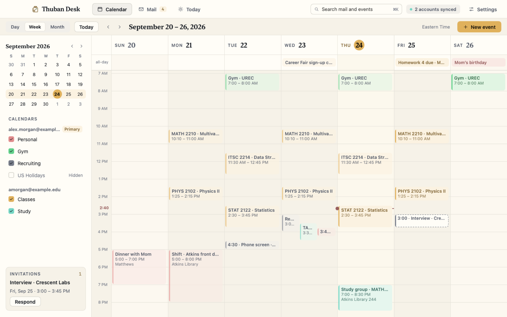
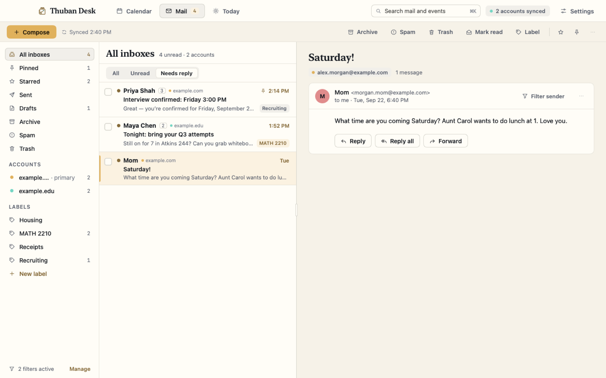
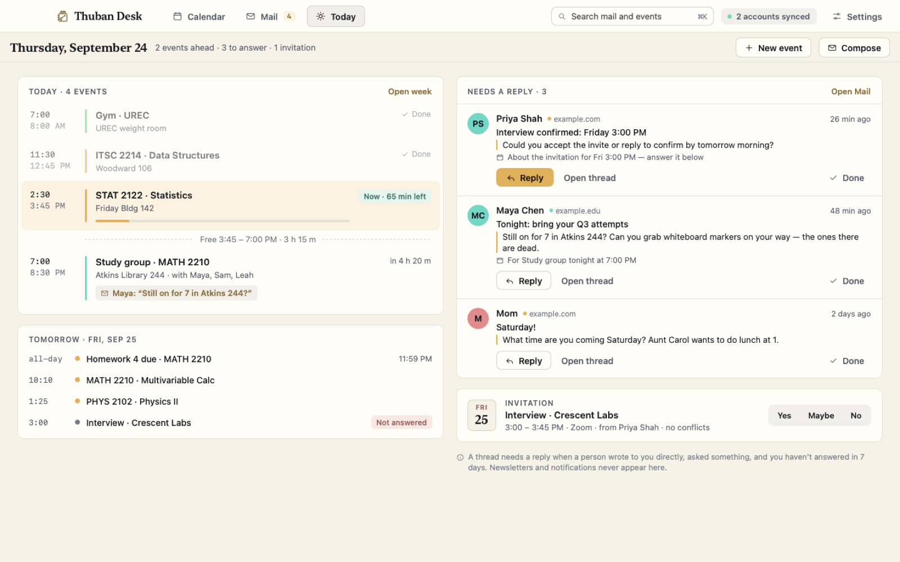
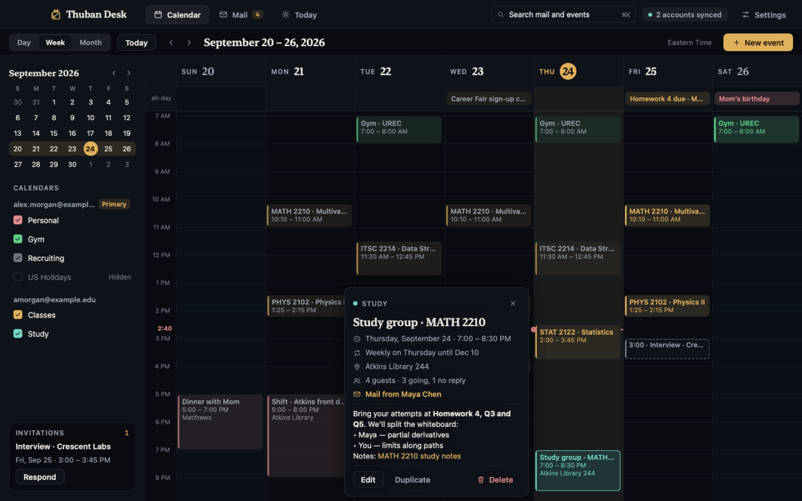
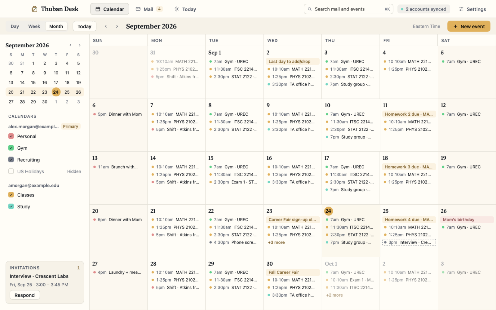
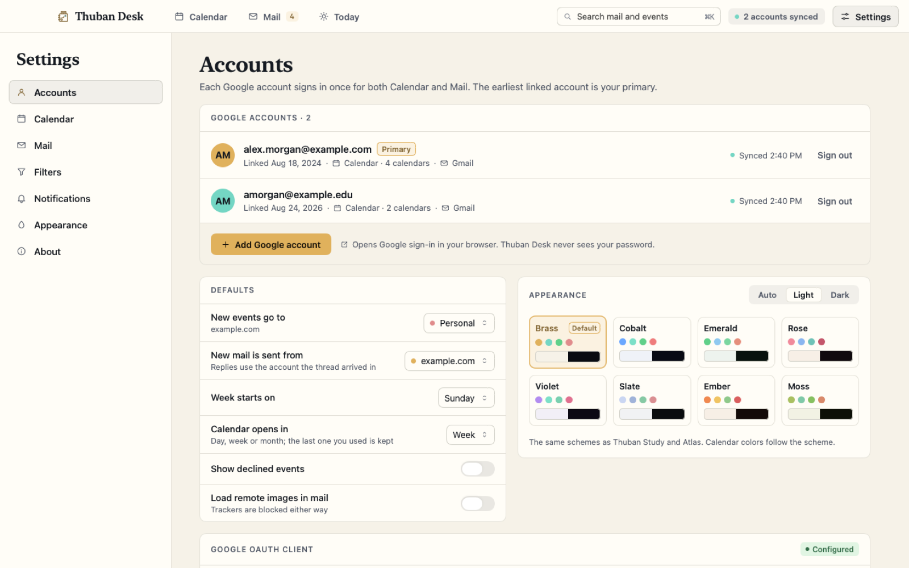

# Thuban Desk

**Google Calendar and Gmail for several accounts, in one quiet native Mac app.**



## Why

A student's day lives in two or three Google accounts: a personal address, a school address, maybe a work one. The
web clients make you switch between them, and every tab is a browser tab. Thuban Desk puts every linked account's
calendars and inboxes side by side in a single SwiftUI app, adds a Today view that answers "what's next and who is
waiting on me", and treats anything irreversible, including sending mail, as something you confirm explicitly.

## Features

**Calendar**
- Day, week and month views with a mini-month navigator, a live "now" line and an all-day row
- Calendars from every account in one sidebar: show/hide per calendar, colors follow the app's theme
- Event editor with all-day toggle, time zones, location, guests, and rich-text descriptions (sanitized HTML)
- Repeating events: a recurrence builder (daily/weekly/monthly, specific weekdays, ends on a date or after N times)
  with a plain-English summary, and a "this event / this and following / all events" prompt when you edit one
- Invitations panel and RSVP (Yes / Maybe / No) from the calendar, the event popover or the invitation email
- Event popover with Edit, Duplicate and Delete (delete always asks first)

**Mail**
- All inboxes merged across accounts, or one account at a time; Pinned, Starred, Sent, Drafts, Archive, Spam, Trash
- Labels merged by name across accounts; apply, remove and create labels
- Archive, read/unread, star, spam, trash and labels act instantly (optimistic, like Gmail), one thread or in bulk
- Filters: All / Unread / **Needs reply**, plus Gmail filter management and "Filter sender"
- Conversation reader in a sandboxed WebView: JavaScript off, remote images blocked by Content Security Policy until
  you choose "Load images", links open in your browser
- Calendar invitations rendered inline with free/busy context ("Free then, after PHYS 2102 ends at 2:15") and RSVP
- Rich-text compose, reply, reply all and forward; replies always go out from the account the thread arrived in;
  drafts autosave
- Delete forever and Empty Trash, both behind a confirmation

**Today**
- Today's agenda with Done / Now / upcoming states, a progress bar for the current event and the free gaps between
- Tomorrow at a glance, including unanswered invitations
- **Needs a reply**: threads where a person wrote to you directly, asked something, and hasn't heard back in 7 days,
  with the question quoted; newsletters and notifications never appear
- One-click Reply, New event and Compose

**Accounts and settings**
- Any number of Google accounts, each signed in once for both Calendar and Mail; the first linked is the primary
- Defaults for new events and outgoing mail, week start, declined events, remote images
- Title-bar search (⌘K) across mail and events; keyboard shortcuts ⌘1-3 for areas, ⌘N, ⌘R
- Eight color schemes plus a custom one, Auto / Light / Dark, shared with the other Thuban apps; the Dock icon is
  redrawn in the current scheme
- A step-by-step Google Cloud setup guide built into Settings

**iPhone and iPad** (`DeskiOS` target, iOS 18+): the same core and stores with a native mobile UI: Today,
Calendar (week strip, time grid, month + agenda, editor), Mail with swipe actions and select mode, Search and
Settings, plus a three-column sidebar/list/thread layout on iPad and local-only notifications. It builds and runs
in the iOS Simulator today; installing on a device needs your own Apple signing team.

## Screenshots

<table>
  <tr>
    <td></td>
    <td></td>
  </tr>
  <tr>
    <td align="center">Mail: one list for every account, filtered to Needs reply</td>
    <td align="center">Today: agenda, free time, threads waiting on you</td>
  </tr>
  <tr>
    <td></td>
    <td></td>
  </tr>
  <tr>
    <td align="center">Dark mode, with a recurring event's popover</td>
    <td align="center">Month view</td>
  </tr>
  <tr>
    <td colspan="2"></td>
  </tr>
  <tr>
    <td colspan="2" align="center">Settings: linked accounts, defaults and color schemes</td>
  </tr>
</table>

All screenshots come from the app's built-in offline fixture data; every account and person in them is fictional.

## Built with

- Swift and SwiftUI, macOS 15+ (iOS/iPadOS 18+ for `DeskiOS`), Xcode 26
- [XcodeGen](https://github.com/yonaskolb/XcodeGen): the Xcode project is generated from `project.yml` and not committed
- A local Swift package, `ThubanDeskCore`, for everything that isn't UI, unit-tested with `swift test`
- Google Calendar API v3 and Gmail API over `URLSession`, with OAuth 2.0 + PKCE (no Google SDK)
- [SwiftSoup](https://github.com/scinfu/SwiftSoup) for HTML sanitizing; WKWebView for the mail reader
- `ASWebAuthenticationSession` for sign-in on iOS

**How it was built:** designed and directed by me; the code was written with
[Claude Code](https://claude.com/claude-code) (AI-assisted), with every screen checked against design artboards
through an offline screenshot harness.

## Architecture

The full contract, including the safety rules and data flow, is in [ARCHITECTURE.md](ARCHITECTURE.md).

- **`Packages/ThubanDeskCore`**: Google OAuth (loopback redirect + PKCE on macOS, reversed-client-ID redirect on
  iOS), a `GoogleClient` actor (token refresh, pagination, backoff on 429/5xx, never retries a send on a 5xx),
  Calendar and Gmail models and endpoints, an RRULE parser/expander and recurrence-edit planner, a MIME parser and
  builder, the Needs-reply classifier and Today agenda.
- **`ThubanDesk/`**: the macOS app: an `@Observable` `AppModel` root with `CalendarStore` and `MailStore`, and
  SwiftUI views per area (Shell, Calendar, Mail, Today, Settings).
- **`DeskiOS/`**: the iPhone/iPad app, reusing the core package plus the platform-neutral app files (model,
  stores, theme, icons) listed in `project.yml`.
- **Write safety**: every write passes a `WriteGate`; sending needs a `Confirmed` token that only the confirmation
  sheet can mint, and destructive actions (delete event, delete forever, sign out) take an explicit `confirmed:`.
- **Offline by default in development**: `THUBAN_DESK_FIXTURES=1` swaps Google for an in-process fake seeded with
  sample data that refuses sends and every non-Google host; tests use URLProtocol stubs only.
- **Visual smoke tests**: `scripts/smoke.sh` launches the app against the fixtures with a pinned clock, walks every
  registered screen and writes a PNG of each.

## Getting started

### Requirements

- macOS 15 or later and Xcode 26 (Swift 6 toolchain)
- XcodeGen (`brew install xcodegen`)
- For the iOS target: an iOS 18+ simulator runtime
- A Google account and your own Google Cloud OAuth client (below)

### Build, test, install

```sh
scripts/build.sh            # regenerate the project and build (Debug, ad-hoc signed)
scripts/test.sh             # core unit tests: fixtures and stubs only, never touches Google
scripts/smoke.sh            # offline visual smoke: screenshots of every screen into .build/smoke
scripts/install.sh          # Release build copied to /Applications/Thuban Desk.app

scripts/ios_build.sh        # DeskiOS simulator build
scripts/ios_smoke.sh        # offline iPhone + iPad screenshots
scripts/ios_install.sh      # install into an iOS simulator (and a paired iPhone if DEVELOPMENT_TEAM is set)
```

`scripts/regen.sh` regenerates `ThubanDesk.xcodeproj` if you want to open it in Xcode. To try the app without a
Google account, launch the built binary with `THUBAN_DESK_FIXTURES=1`.

### Connect Google (your own OAuth client)

Thuban Desk ships no client ID or secret. Each user talks to Google through an OAuth client in their own Cloud
project, so no data passes through anyone else. The same steps are in **Settings → Accounts → Google OAuth client**.

1. **Create a Google Cloud project** in the [Cloud Console](https://console.cloud.google.com/projectcreate). No
   billing is needed.
2. **Enable the Gmail API and the Google Calendar API** under APIs & Services → Library.
3. **Set up the consent screen** in Google Auth Platform: Audience "External", and add each Google address you will
   link as a test user.
4. **Create a Desktop OAuth client**: Google Auth Platform → Clients → Create client → Application type
   "Desktop app". Copy the Client ID and secret, or download the JSON.
5. **Paste the client into Thuban Desk** (or import the downloaded JSON), press Save, then **Add Google account**.
   Your browser opens Google's sign-in; since it's your own unverified project, choose Continue and allow Calendar
   and Gmail.
6. **Optional:** while the project is in "Testing", Google expires sign-ins after 7 days. Publishing the app under
   Audience (no review needed for personal use) keeps them alive.

The app requests `gmail.modify`, `gmail.send`, `gmail.settings.basic`, `https://mail.google.com/` (needed for
Delete forever / Empty Trash) and `calendar`.

**iOS:** create an **iOS** OAuth client instead, copy `DeskiOS/Config/Secrets.example.xcconfig` to
`DeskiOS/Config/Secrets.xcconfig` (gitignored) and set `GOOGLE_IOS_CLIENT_ID` to the part of the client ID before
`.apps.googleusercontent.com`. The build registers the matching redirect URL scheme. iOS sign-in uses PKCE and no
client secret.

## Privacy

- Thuban Desk talks only to Google's APIs. There is no server, analytics or telemetry.
- Your OAuth client and every account's tokens are stored locally in
  `~/Library/Application Support/Thuban Desk/credentials.json`, written with file mode `0600` inside a `0700`
  folder. The Keychain is deliberately not used, so an ad-hoc-signed build doesn't prompt on every launch. On iOS
  the file lives in the app container with `NSFileProtectionComplete`.
- Mail and events are cached on disk in the same folder for fast startup.
- Sign-in happens in your browser; the app never sees your Google password. Signing out revokes the account's token and forgets its cached data.
- Remote images in mail are blocked until you load them, so senders can't tell you opened a message.

## Part of the Thuban suite

Thuban Desk shares its theme engine, components and color schemes with the other Thuban apps:

- [Thuban Study](https://github.com/GITHUB_USER/thuban-study)
- [Thuban Graph](https://github.com/GITHUB_USER/thuban-graph)
- [Thuban Canvas](https://github.com/GITHUB_USER/thuban-canvas)
- [Thuban Gym](https://github.com/GITHUB_USER/thuban-gym)
- [Thuban Planner](https://github.com/GITHUB_USER/thuban-planner)

---

All rights reserved.
